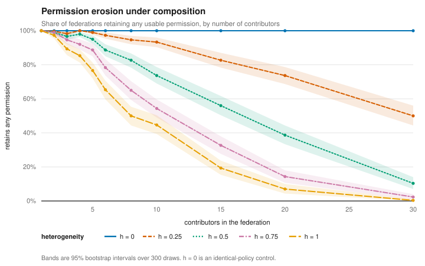
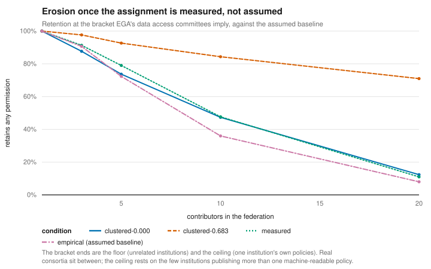
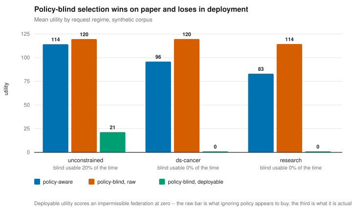
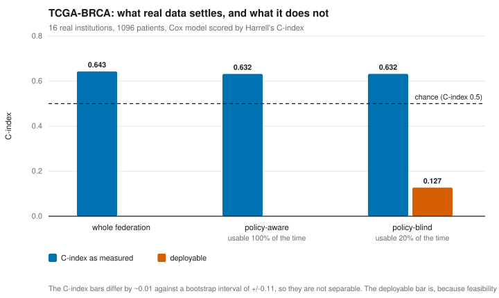
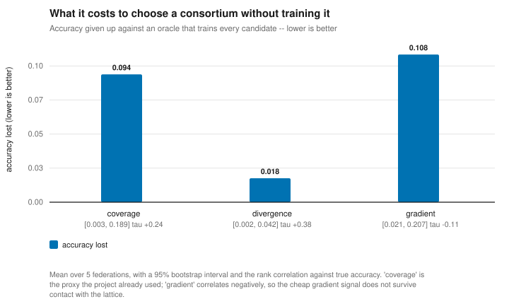

# Policy-Carrying Models

**ODRL usage policies that compose through federated aggregation.**

A trained federated model is a *derivative* of every contributor's data. If
those contributors granted their data under different conditions, what may
lawfully be done with the resulting model? ODRL defines no composition
semantics for derived assets, and FL makes the question unavoidable, because
aggregation is the primitive.

This project defines that composition, and builds the machinery to enforce it
inside a federated training run.

> Status: **increment 4 complete — the go/no-go passed.** Permission erosion is
> real, large, and driven by policy diversity rather than federation size.
> Increments 5–11 proceed with one revision to scope, below.

## The core claim

Composing contributor policies gives a capability set that is **anti-monotone**
in the contributor set:

```
S ⊆ S'   ⟹   Cap(S') ⊆ Cap(S)
```

Permissions intersect, prohibitions and duties accumulate, constraints conjoin.
So **admitting a contributor can never widen what you may do with the model, no
matter how permissive that contributor is** — it can only add data. Removing one
can only widen it.

Two consequences:

- **Permission erosion.** The more institutions you federate, the fewer things
  you are allowed to do with the result. This runs directly against the "more
  participants is better" instinct.
- **A trade-off with structure.** Capability is anti-monotone; data utility is
  (roughly) monotone increasing. Selection is choosing a point on that frontier.
  Anti-monotonicity also gives Apriori-style pruning: if a subset already lacks
  a required capability, every superset lacks it too.

## The algebra, and what it already shows

```bash
python experiments/compose_demo.py
```

Composing every subset of the five example contributor policies:

```
Mean capability by federation size:
  1 contributor(s)  3.00  ##################
  2 contributor(s)  2.30  ##############
  3 contributor(s)  1.80  ###########
  4 contributor(s)  1.40  ########
  5 contributor(s)  1.00  ######
```

Note `p3`, the national registry: it holds the most valuable data and grants
only `aggregate`, so **any** subset containing it collapses to that alone — the
federation could not even run inference with the resulting model.

Composition rules, all pushing the same direction:

| Element | Rule |
|---|---|
| Permissions | intersect — an action needs everyone's grant |
| Prohibitions | union — any single prohibition binds the derivative |
| Duties | union, merged per action — the strictest wins |
| Constraints | conjoin — set meet, or interval intersection |
| Conflict | deny overrides |

Capability is lost three distinct ways, and `CompositionResult.lost` separates
them so increment 4 can ablate their contributions: somebody withheld the
grant, somebody prohibited it, or the grantors' constraints have no common
ground.

### Subsumption is load-bearing, not decorative

`spatial isAnyOf {EU}` and `spatial isAnyOf {DE}` are compatible — Germany is in
the EU — and their meet is `{DE}`. Under a flat vocabulary they read as a
conflict and the capability is lost. Compare:

```bash
python experiments/compose_demo.py --flat
```

`p1+p4` keeps `use` with the taxonomy and loses it without. Measured erosion
would otherwise be partly an artifact of omitting the hierarchy rather than a
property of the policies, which would undermine increment 4's headline result.

## Grounding: GA4GH Data Use Ontology

```bash
python experiments/corpus_demo.py
```

The corpus is not invented. Code sets are sampled from **real data use
conditions** published on EGA policy records, fetched once and committed to
`vocab/duo_frequencies.json` with provenance:

```
404 of 3000 policies carry DUO codes -- 13.5% adoption
```

That number is a finding, not an inconvenience: structured, machine-readable
data use conditions are the exception in practice. So is the fact that
`DUO:0000005` (GRU-CC) and `DUO:0000014` (RU) account for 132 code occurrences
despite having been **retired from the ontology** — real governance metadata
drifts from the standard, and a tool that meets real data has to decide what to
do with obsolete terms.

Erosion over a corpus of 40 DUO-derived contributors:

```
  size  mean capability  retains any
     1             4.00        100%
     5             3.65         91%
    10             2.45         61%
    20             1.30         32%
    40             0.00          0%
```

Measured over *sampled* subsets rather than a prefix: individual subsets are
bimodal, since a single incompatible contributor collapses a whole subset to
nothing.

### Not every DUO code fits, and that is part of the result

`vocab/duo.json` classifies all 28 observed codes:

| Class | n | Meaning |
|---|---|---|
| `permission` | 8 | sets the purpose the data may serve (GRU, HMB, DS) |
| `restriction` | 8 | a constraint or prohibition the algebra folds (NCU, GS, TS, NMDS) |
| `externally-adjudicated` | 4 | composes syntactically; an authority decides its truth out of band (IRB, US, PS, IS) |
| `deprecated` | 3 | obsolete, still present in real annotations |
| `duty` | 2 | an obligation rather than a restriction (PUB, RTN) |
| `structural` | 2 | an ontology category, not a usable condition |
| `out-of-fragment` | 1 | **COL** — cannot be expressed at all |

**COL is the interesting one.** "Collaboration required" means the data
provider must be a participant, so its satisfaction depends on the very
contributor set being composed. That is self-referential — precisely the class
the fragment excludes. A widely-used standard containing a construct the
algebra cannot take is worth reporting rather than hiding.

Every code carries a `fidelity` field (`exact` or `interpretive`), so the
places where DUO and ODRL do not line up cleanly are visible.

## The result: permission erosion is real



```bash
python experiments/run_erosion.py
```

40 DUO-derived contributors, 60 subset draws per size, 5 corpus seeds,
95% bootstrap intervals (bootstrap because the statistic is bimodal — a subset
either keeps its capability or loses all of it):

```
  size          capability  retains        purpose retained  duties
     1    4.00 [4.00,4.00]    100%     0.587 [0.551,0.624]    0.20
     3    3.57 [3.44,3.71]     89%     0.295 [0.266,0.324]    0.62
     5    3.07 [2.87,3.25]     77%     0.195 [0.170,0.220]    0.85
    10    1.79 [1.56,2.01]     45%     0.072 [0.059,0.087]    1.10
    20    0.28 [0.17,0.40]      7%     0.006 [0.003,0.009]    1.39
    30    0.01 [0.00,0.04]      0%     0.000 [0.000,0.001]    1.56
```

Note the two columns moving in opposite directions. **Capability falls while
duties accumulate** — permissions intersect and obligations union — so a growing
federation simultaneously loses what it may do and gains what it must do.

At `heterogeneity = 0` the same curve is perfectly flat at 4.00 / 100% for every
size. **Erosion is a property of policy diversity, not of federation size.**

### Go/no-go verdict

| Criterion | | Result |
|---|---|---|
| non-trivial | PASS | capability 4.00 → 1.79 at 10 contributors (55% drop), intervals disjoint |
| non-degenerate | PASS | 45% of 10-contributor subsets retain capability |
| attributable | **FAIL** | purpose=98%, spatial=2% |
| diversity-driven | PASS | 0% drop homogeneous vs 55% diverse |

Criteria were fixed **before** the study ran, and the blocking/advisory split
was fixed with them: a trivial or degenerate result stops the project, a
surprise about mechanism calls for rescoping. Both blocking criteria passed.

**The `attributable` failure is a finding, not a defect,** and the criterion was
mis-specified rather than the data disappointing. It expected several
mechanisms; the data says erosion is almost entirely **incompatible research
purposes**. That follows from the vocabulary: DUO expresses *limitations*, so
every contributor grants the same actions and a withheld grant cannot occur,
while its only prohibitions are constrained and refine a permission rather than
removing it. One mechanism at action level is a property of DUO, not an
artifact of the algebra.

The revised claim is sharper than the one planned: *if you want to federate,
purpose compatibility is the thing to negotiate.* That also tells increment 5's
selection search what to prioritise.

**Robustness.** Re-running with only `use` granted — the alternative reading of
what DUO licenses — gives 59% drop and 41% retention against 55% and 45%, with
the same attribution. The conclusions do not rest on the `DEFAULT_ACTIONS`
assumption.

### How much does this depend on *who holds which policy*?

```bash
python experiments/run_sensitivity.py
```

This was the main threat to validity, and it is now partly measured rather than
wholly assumed — see [the measured bracket](#what-the-measurement-settles)
below. The assumed models are kept because they still bound the answer, and
because the comparison is the point.

EGA supplies real code frequencies and real co-occurrence. Which institution
holds which conditions had to be assumed. Seven assignment models, same curve:

| assignment model | drop at 10 | retains any | effect |
|---|---|---|---|
| uniform | 76% | 24% | large |
| **empirical** (baseline) | 64% | 36% | large |
| clustered-0.3 | 49% | 51% | moderate |
| **purpose-matched** | 42% | 58% | moderate |
| marginal | 32% | 68% | small |
| clustered-0.6 | 17% | 83% | small |
| clustered-0.9 | 5% | 95% | small |

**Erosion occurs under every model — the direction is robust. The magnitude is
not**, ranging from 5% to 76%. Stated plainly: had `clustered-0.6` been chosen
as the baseline, the pre-registered go/no-go criterion would not have been met.
Any figure quoted in the paper must name its assignment model.

Cohesion is what drives it. Erosion decays smoothly as consortium members come
to resemble one another and largely disappears once most are alike — which is
the honest answer to "but real consortia are thematically coherent."

**The load-bearing row is `purpose-matched`.** A consortium that has *already*
self-selected for compatible research purposes still loses 42% of its
capability, because **compatibility is not transitive**: two members can each be
compatible with the anchor and incompatible with one another
(`research ⊓ ds-cancer` and `research ⊓ ds-neurological` are both fine;
`ds-cancer ⊓ ds-neurological` is empty). Self-selection is necessary but not
sufficient — which is precisely the argument for selecting explicitly, and why
selection is a set-level search rather than a filter.

### What the measurement settles

```bash
python -m odrl_fl.ega --fetch          # once; the corpus is committed
python experiments/run_measured.py
```



The assignment does not have to be assumed. EGA's `/policies` endpoint returns
`dac_accession_id` beside `duos` — the Data Access Committee that issues each
policy — so which conditions travel together *because the same institution
issued them* is observable. `experiments/fetch_duo_frequencies.py` had been
discarding that field.

`odrl_fl/ega.py` keeps it. From 4 817 EGA policies, **1 031 carry structured DUO
conditions** (21.4% adoption) across **899 committees**.

**Cohesion is recoverable from an agreement rate.** `_clustered_sampler` defines
it exactly — with probability `c` a contributor adopts a shared archetype,
otherwise it draws empirically — so for two contributors the chance of an
identical code set is `c² + (1−c)²·p + 2c(1−c)·w`, where `p` is the chance two
independent draws coincide. The archetype is drawn from that same distribution,
so `E[w] = p` and the quadratic collapses to `agreement = p + c²(1−p)`,
inverting to `c = sqrt((agreement − p) / (1 − p))`.

| quantity | measured | implies cohesion |
|---|---|---|
| chance coincidence `p` | 0.0131 | — |
| agreement between different DACs | 0.0118 | **0.000** (floor) |
| agreement within one DAC | 0.474 [0.349, 0.595] | **0.683** [0.584, 0.768] (ceiling) |

It is a bracket and not a point on purpose. **A DAC is not a consortium** — it is
one institution issuing several policies, the most homophilous grouping
obtainable, so its internal agreement bounds cohesion from *above*. Unrelated
committees bound it from *below*, and they agree slightly **less** than chance
(0.0118 against 0.0131), which the clustered model cannot express at all: it can
add homophily, never subtract it. The floor is therefore zero.

| condition | drop at 10 | retains any |
|---|---|---|
| `clustered-0.683` — measured ceiling | 16% | 84% |
| **`measured`** — real code sets, real institutions | **52%** | **48%** |
| `clustered-0.000` — measured floor | 53% | 47% |
| `empirical` — the assumed baseline | 64% | 36% |

**The range narrows from 69 points wide to 37.** The seven assumed models spanned
7%–77%; the measured bracket spans 16%–53%.

**What it does not settle, stated plainly.** At the ceiling the drop is 16%, so
the admission made above about `clustered-0.6` (17%) applies unchanged: at that
end of the bracket the pre-registered go/no-go criterion would still not have
been met.
Measuring the assignment halved the uncertainty; it did not eliminate it.

Two things argue the ceiling is the wrong place to stand, and neither is
decisive. The ceiling assumes a consortium is as internally consistent as a
single institution's own policy portfolio, which is not what a consortium is.
And the `measured` row assumes nothing at all — it draws whole code sets from
the real committees that published them, with whatever correlation structure
EGA actually has — and lands at 52%, next to the floor rather than the ceiling.

**The ceiling rests on 57 institutions**, the only ones in EGA publishing more
than one machine-readable policy. That is a thin sample, and it is also a
finding: alongside the 21.4% adoption rate, it says structured data-use policy
is not yet common practice. The interval on that estimate is reported everywhere
it is quoted, and should be.

## Selection: recovering a usable consortium



Erosion says a federation assembled without regard to policy usually cannot
lawfully use the model it produces. Selection turns that into a search: among
all subsets of a pool, find those whose composed policy satisfies a stated
requirement, and among those, the ones offering the most data.

**It is a search, not a filter.** Because compatibility is not transitive,
candidates cannot be vetted one at a time against a reference policy —
feasibility is a property of the set. Two contributors can each satisfy the
requirement alone and grant nothing together
(`tests/test_selection.py::test_two_viable_contributors_can_be_jointly_infeasible`).

**It is tractable anyway.** Anti-monotonicity makes feasibility *downward
closed*: every subset of a feasible set is feasible, so a contributor that fails
alone can be dropped from the pool outright, and a (k+1)-set need only be
considered when all its k-subsets are feasible. That is exactly Apriori's
candidate generation. The pruning is sound only on the legal side — utility is
empirical and not reliably monotone, so pruning on it could discard the optimum.

A test asserts the search returns **exactly** the maximal sets an exhaustive
scan finds, across several seeds. Pruning must not cost completeness.

### A request asks for containment, not overlap

Getting this wrong quietly voids the whole exercise, and it did at first. A
request constraint was tested with `taxonomy.meet` — non-empty intersection — so
an agreement permitting only `biomedical-research` answered *yes* to "may we use
this for research". A consortium would believe it held a right it did not have.

It also made the purpose knob a no-op: because `research` overlaps nearly every
DUO-derived purpose in the corpus, runs with and without a purpose constraint
produced byte-identical search statistics. The fix is `taxonomy.difference` —
every term the request names must already be permitted. On the request side
`isAnyOf {a, b}` reads as "either branch may be taken", so both must be granted:
you cannot know in advance which one gets taken, and a consortium that is only
*sometimes* lawful is not a viable consortium.

### Request tightness is what makes selection hard

Pool of 16, 5 corpus seeds, requiring `use` and `aggregate`:

| request | viable alone | subsets evaluated | search space avoided | policy-aware yield | policy-blind yield |
|---|---|---|---|---|---|
| actions only | 16.0/16 | 25,634 | 60.9% | 100% | 20% |
| `purpose = ds-cancer` | 12.8/16 | 10,652 | 83.8% | 100% | 0% |
| `purpose = research` | 9.0/16 | 889 | **98.6%** | 100% | 0% |

**Deployable utility** — data drawn from a consortium actually permitted to use
it — is the only comparison that counts. A policy-blind consortium scores its
full data volume when it happens to be feasible and zero otherwise:

| request | policy-aware | policy-blind |
|---|---|---|
| actions only | 114.2 | 21.4 |
| `purpose = ds-cancer` | 95.9 | 0.0 |
| `purpose = research` | 83.1 | 0.0 |

Read the two ends of the pruning column together rather than quoting the
favourable one. **Apriori pays off precisely where selection is hard**, and
degenerates toward exhaustive enumeration where the requirement is so permissive
that almost any consortium would have satisfied it anyway. That is a property of
the problem, not a deficiency of the algorithm: the feasible family really is
that large when the constraint is weak — 14,463 feasible sets out of 65,535 at
seed 0 under the unconstrained request.

Two caveats worth stating plainly. The 100% policy-aware yield is **structural,
not empirical**: the search returns maximal feasible sets, so it succeeds
whenever any contributor is viable alone. The interesting column is the
policy-blind one next to it. And finding maximal sets by enumerating the whole
feasible family is exponential in that family's size; `max_size` caps it, but no
better algorithm is implemented.

## The federation selects its own members

Everything above is an offline study. This is where it becomes a system: the
server decides *who trains* from the composed policy, before the first round.

Stock `FedAvg` samples participants at random from the Grid
(`flwr/serverapp/strategy/fedavg.py`). That is not bad statistics -- it simply
takes no position on whether the resulting model may lawfully exist.

**Contributors declare; the server does not assume.** A `@app.query()` round
runs before `strategy.start()`. Each node translates its own DUO codes locally
and replies with an ODRL Offer as JSON-LD; the server composes what it is told,
searches for a feasible consortium, and addresses only the admitted nodes. The
server could have looked the policies up in the same corpus the studies use,
and that would be simpler -- but a server that invents its clients' consent
terms demonstrates nothing.

```
declaration round: 10 nodes answered
  node  0   464 samples  3/4 classes  DUO:0000006, DUO:0000018
  node  1   452 samples  4/4 classes  DUO:0000007, DUO:0000015, DUO:0000016, ...
  ...
admitted 7 of 10: [0, 3, 4, 6, 7, 8, 9]
  excluded node 1 -- terms do not compose with the selected consortium
  excluded node 2 -- terms do not compose with the selected consortium
  excluded node 5 -- terms do not compose with the selected consortium
the federation may: aggregate, derive, distribute, use
and owes: inform
```

Three design commitments worth stating.

**No feasible consortium is fatal.** `admit` raises rather than falling back to
training on everyone. That fallback would produce exactly the unusable model
this project is about, and would do it silently.

**A declaration that cannot be parsed excludes the node.** Never admitted on a
default -- guessing at consent terms is the one failure mode all of this exists
to prevent. Nodes that stay silent are recorded as such, not assumed benign.

**Evaluation is restricted too, not just training.** An excluded node does not
see the model at all, not even to score it.

The decision logic is a pure function over declarations, with no Grid, no
transport and no clock, which is what makes it testable: Ray publishes no
Windows wheel for Python 3.13, so no test here can start a real federation. A
`FakeGrid` covers message addressing, and
`test_only_admitted_nodes_are_addressed` is the load-bearing check -- if the
strategy ever addressed an excluded node, the federation would train on data it
was not permitted to use.

### What it costs, end to end

`experiments/policy_aware_demo.py` runs declarations through admission into
actual training, in-process. Ten nodes, requiring `use` and `aggregate` for
`ds-cancer`:

| consortium | members | accuracy | permitted to use it |
|---|---|---|---|
| policy-aware | 7 | 0.735 | **yes** |
| policy-blind | 7 | 0.939 | no |

The policy-blind consortium trains the better model here. Whether it does so
varies by seed and is beside the point: **deployable accuracy is 0.735 against
0.000**. An undeployable model has no accuracy worth quoting, and what
selection buys is the right to use the result at all.

## What a federation owes, and what a system can do about it

Selection settles what the consortium *may* do. The other half of an agreement
is what it *must* do, and here the interesting result is a negative one.

**Duties differ by when they are discharged, and that decides what a system can
do about them.** Three postures:

| posture | mechanism | is it enforcement? |
|---|---|---|
| **gate** | the run refuses to start without evidence the duty was discharged | **yes** -- the training does not happen |
| **dispatch** | requirement goes into the training config; updates lacking a matching claim are dropped before aggregation | partly |
| **record** | carried in an obligation ledger, attributed and open | **no** -- accountability only |

### The duties real annotations produce are almost all unenforceable

Across the corpus, GA4GH DUO yields exactly three duties, and **none of them is
something a client computes during training**:

| duty | from | posture | discharged |
|---|---|---|---|
| `obtainConsent` | DUO:0000021 IRB | gate | before the run, by an ethics committee |
| `inform` | DUO:0000019 PUB | record | after the model exists (publish results) |
| `transfer` | DUO:0000029 RTN | record | after (return findings to the source) |

The one duty a client *could* act on mid-training -- `anonymize` under a
`dpEpsilon` budget -- appears only in the hand-written profile fixtures, because
**DUO has no vocabulary for it**. `tests/test_duties.py::TestTheDomainFinding`
asserts this, so if a vocabulary change ever makes it false the tests fail and
this section gets rewritten rather than quietly going stale.

That is a claim about the domain, not about this implementation, and it points
somewhere specific: for real data-use terms the useful machinery is provenance
and accountability, not runtime interception. Which is what increment 8 builds.

### Two limits, stated rather than buried

**The attestation gap.** In the dispatch posture the server verifies that a
client *said* it complied, never that the computation happened. A client
reporting an epsilon it never applied is undetectable from here; closing that
needs secure aggregation or hardware attestation. Named as future work, not
attempted.

**The noise is not calibrated differential privacy.** `task.privatise` clips the
update norm and adds Gaussian noise scaled by the declared budget. There is no
sensitivity analysis, no delta, and no accounting of privacy loss composed
across rounds -- all three are needed before an epsilon means what the DP
literature means by it. It is a real transformation obeying a policy-named
budget, which is enough to demonstrate dispatch and verification end to end, and
it is not a privacy guarantee.

### Three design commitments

**Silence fails.** A reply that reports nothing about its directives is dropped.
On the wire it is indistinguishable from a reply that skipped the duty, and only
one of those is safe to aggregate.

**Unknown duties are recorded, never ignored.** A duty action nobody wrote a
handler for classifies as `record` and is carried as outstanding. The
alternative -- skipping what the code does not recognise -- would make an
unhandled obligation look discharged.

**Outstanding is never rendered as satisfied.** The ledger marks recorded duties
open and names who owes them, so a list of unmet obligations cannot be mistaken
for a clean bill of health.

```
duties
  GATE      obtainConsent -- must be evidenced before starting
  RECORD    inform -- OUTSTANDING, owed by all 7 members
cleared obtainConsent, evidence IRB-2026-0142
```

Without evidence, the run refuses to start:

```
REFUSED TO START: the agreement requires obtainConsent before any training
may happen, and no evidence was supplied.
```

## Policy-carrying models

A trained federated model is a derivative of every contributor's data, and the
composed Agreement says what may lawfully be done with it. Separate those two
and the terms are lost the first time the file is copied.

A bundle keeps them together and makes the pairing **checkable**:

```
bundle/
  model.pt        the weights
  manifest.json   the agreement, every declaration, what remains owed
```

```
model    1e94832d28ccb460
terms    urn:agreement:2989fa843e1be36b
built by 7 contributors
you may  aggregate, derive, distribute, use
cleared  obtainConsent, evidence IRB-2026-0142
YOU OWE  inform -- to all 7 contributors
```

**This is what increment 7 pointed at.** The duties real DUO annotations produce
are almost all discharged *after* the model exists, by whoever holds it. A
holder who does not know what is owed cannot discharge any of them, so carrying
the ledger with the weights is what makes those obligations actionable at all.

### Verification is substantive

`verify` does not check a digest against itself. It **recomposes** the agreement
from the contributor declarations recorded in the manifest and confirms the
result matches what the manifest claims, then checks the weights still hash to
what was recorded. Widening a purpose therefore requires forging every
contributor's declaration to justify the change:

```
VerificationError: the recorded contributor policies do not compose to the
recorded agreement
```

The bundle is self-contained -- no registry, no external state to consult.

**What it is not: signed.** A forger who rewrites the declarations *and* the
agreement consistently produces a bundle that verifies.
`test_an_unsigned_manifest_can_be_rewritten_wholesale` asserts exactly that, so
the limit is never mistaken for a guarantee. Detection covers accident and
one-sided edits; closing the rest needs signatures over the digest and a key
distribution story.

### Policy-carrying is recursive

An Agreement is a Policy, so a bundle's agreement composes straight back in when
the model is reused. Capability can only narrow -- **a restricted model cannot
be laundered into an unrestricted one by training something else on it.**

That recursion is what makes the term mean something, and it is also what forced
a fix in the algebra. Composition used to apply an exclusion and then discard
it, because `difference` is conservative (`world \ EU` is just `world`, since
"EU except DE" is not expressible). Composing all of `isAnyOf {world}`,
`isNoneOf {EU}` and `isAnyOf {EU}` correctly denies the action, but composing
the first two into an Agreement and then adding the third **permitted** it --
non-associativity in the over-permissive direction, found by Hypothesis. An
Agreement that had silently dropped a carve-out could license a reuse the
contributors jointly forbade. Composition now keeps the narrowed permission and
the exclusion side by side. No published number moves: neither study
re-composes an Agreement.

## Consent changes: membership over time

Every increment so far treated a federation as a decision made once. Real
consent is not. A time limit lapses mid-run, an institution withdraws, a member
stops evidencing a duty it agreed to. The server now re-asks every active node
between rounds and drops the ones that no longer qualify -- withdrawn, expired,
unreachable, or in repeated breach. Undoing a *past* round would be machine
unlearning, which is a different research problem.

That conservative response creates a trap, and avoiding it is the increment.

### Departure widens the rights of whoever is left

Capability is anti-monotone, so removing a contributor can only **widen** what
the rest may do -- the restrictive member takes their restriction with them.
Recomposing over current membership therefore yields a *broader* agreement than
the run started under, and every step of that reasoning is correct.

It is still wrong, because the departed member's data is already in the weights.
Rounds 1..k were trained on it and no later round removes it. An agreement
composed over who is left would license uses of that data which its owner never
granted -- reached by correct reasoning from a premise that quietly stopped
holding.

So the licence follows the **contribution set**, not the active set:

| | |
|---|---|
| `active` | who trains in the next round — may shrink |
| `contributed` | whose data is in the weights — only ever grows |

`governing_agreement` composes over `contributed` and is the model's licence.
`active_agreement` composes over `active` and exists *only* so the gap can be
measured and reported. They are separate functions rather than a flag, because
using the second one as a licence is the whole mistake.

### How often it matters

Over 20 corpora of 10 nodes, counting consortia containing at least one member
whose departure would widen the licence:

| requirement | consortia at risk | members whose departure widens |
|---|---|---|
| actions only | **13/20** | 13/168 (8%) |
| `purpose = ds-cancer` | 8/20 | 8/161 (5%) |
| `purpose = research` | 0/20 | 0/107 (0%) |

Not an edge case at the loose end: two thirds of consortia contain such a
member. The trend is the same one increment 5 found from the other side -- a
tighter request admits a more homogeneous consortium, and at the tightest there
is no restrictive member left to leave, so nothing can widen.

Departures travel in the bundle, because a holder needs to know:

```
NOTE     node 9 left at round 3 (withdrew); its data is still in these weights
```

## TCGA-BRCA: what real data settles, and what it does not



Every number above came from synthetic data split by a Dirichlet draw. Increment
10 runs the same machinery on **1096 TCGA breast-cancer patients**, partitioned
the way the data already was: each patient id carries a Tissue Source Site code,
and those map to named hospitals -- University of Pittsburgh, Walter Reed,
Roswell Park, Mayo, Greater Poland Cancer Center. 16 institutions hold at least
20 patients, with volumes from 150 down to 20. The task is the one the data
supports: a Cox proportional-hazards model scored by Harrell's C-index, 13.8% of
patients having an observed event.

### A premise that did not survive

This README used to say Fed-TCGA-BRCA was the right cohort *because* its dbGaP
controlled-access heritage would let real DUO codes be cited rather than
sampled. **That is wrong**, and checking it was the first thing increment 10
did. The FLamby cohort is the *open-access* GDC clinical tier: unrestricted data
only, with the controlled genetic component deliberately excluded. No dbGaP Data
Use Limitations attach to these rows and there are no DUO codes to cite.

What can be cited is the GDC open-access policy, and it is thin — no purpose
limitation, and one prohibition, on attempting to re-identify a participant.
Expressing even that needs `identify`, which **neither ODRL core nor DUO
defines**; it is a profile extension here. The single enforceable term on the
most widely used open genomics resource has no standard vocabulary term.

### The real terms do not erode

```
one institution   ['aggregate', 'derive', 'distribute', 'use']
all 16 composed   ['aggregate', 'derive', 'distribute', 'use']
```

Sixteen copies of a permissive policy compose to itself. Erosion needs
heterogeneous conditions and the open tier has none — which is precisely why the
phenomenon lives in controlled access, and why it cannot be demonstrated on data
anyone can download. Heterogeneity in the *terms* therefore stays modelled, now
attached to real institutions with real patient counts.

### The dataset is too small to settle model quality

| | C-index |
|---|---|
| centralised, data pooled | 0.668 |
| federated, all 16 sites | 0.686 |
| best single institution | 0.641 (Roswell Park) |
| median single institution | 0.560 |
| bootstrap 95% CI on one estimate | **[0.578, 0.784], ±0.10** |

With 40 events in the held-out fold a single C-index carries roughly ±0.10. The
difference between policy-aware and policy-blind consortia is ~0.015 — an order
of magnitude below the noise. More seeds do not help; the limit is the cohort.

**So the results split cleanly.** Anything combinatorial is settled, because it
follows from composing declared terms and never touches a metric:

| | policy-blind | policy-aware |
|---|---|---|
| permitted to use its own model | **20%** | **100%** |
| deployable C-index | 0.138 | 0.673 |

Anything about model quality is not settled, and the honest answer is that
answering it needs a larger cohort — which for this disease means
controlled-access data, the same tier where the interesting policies live.

### Federated Cox optimises the wrong objective, and this cohort cannot show it

**The Cox partial likelihood is not a sum over clients.** Its risk set spans
every patient still at risk at each event time, so a client computing the loss
over its own cohort optimises a different objective than the federation's.
Averaging those gradients converges correctly to the wrong function, which is why
more rounds do not help. Andreux et al. (2020) reformulate to discrete time for
exactly this reason; naive FedAvg here does not. That argument is mathematics and
holds regardless of what this cohort shows.

**What this cohort shows is nothing, and an earlier version of this section
claimed otherwise.** It reported the federated model at 0.643 against pooling at
0.774 and read the gap as the objective mismatch made visible. On a reproducible
split the two are 0.686 and 0.668 — federated now *ahead* of centralised, by less
than a fifth of the ±0.10 interval either number carries. Both orderings are
noise. The original gap was an artefact of a fold that could not be reconstructed
(see below), and it is recorded here rather than quietly corrected because it is
the clearest example in this repository of a plausible mechanism being credited
for what was really sampling variation.

It does not disturb the comparisons above — both consortia use the same trainer —
and the deployable figures are untouched, because feasibility never depends on a
metric.

### A split that could not be reproduced

`split()` derived its per-site seed from the builtin `hash`, which Python
randomises per interpreter. Every process therefore drew a different train/test
fold from the same nominal `seed=0`: reproducible within a run, never between
runs. It surfaced as an intermittently failing test, but the cost that mattered
was silent — every TCGA figure published here came from a fold nobody could
reconstruct, and the apparent centralised-versus-federated gap was one of them.

The fix is a stable hash (`odrl_fl/tcga.py`, `_site_seed`), with the fold pinned
by golden-value tests so a regression fails loudly.

Regenerating under the fix is also a clean test of this section's own claim about
which results are settled. Every **model-quality** number moved — the C-indices
above all shifted by 0.02 to 0.11. Not one **combinatorial** number did:
consortium sizes and the feasibility column came back byte-identical, because
composing declared terms never touches the data.

The cohort is fetched on demand and gitignored, not vendored: it belongs to the
GDC. Users must not attempt to re-identify participants
([GDC policies](https://gdc.cancer.gov/about-gdc/gdc-policies)).

## Choosing a consortium without training it

```bash
python experiments/run_groundtruth.py     # ~4 hours, resumable
python experiments/run_estimators.py
```


Selection searches a powerset. The legal half of that search is cheap --
composition needs no data and no training, and under a tight request it removed
[98.6% of the space](#request-tightness-is-what-makes-selection-hard). The
utility half is the expensive one, and if scoring a candidate means training it
then the search is affordable only for pools too small to need one.

So: **can a training-free estimator pick the same consortium a trained one
would?** Three are implemented in [`odrl_fl/estimators.py`](odrl_fl/estimators.py),
all of the form *quality × √volume*:

| estimator | quality term | cost |
|---|---|---|
| `coverage` | classes present / 4 | none — the incumbent proxy |
| `divergence` | 1 − JS distance from the target label distribution | none |
| `gradient` | agreement between client gradients at a shared init | one backward pass per contributor |

`gradient` was meant to be the interesting one: O(n) precompute over the pool,
then O(1) per subset, which is what makes querying thousands of candidates viable
at all. It is also the one that fails.



### The question is frontier fidelity, not accuracy

Selection never reads the estimate, only the ordering — so an estimator can be
off by any monotone transformation and still be perfectly useful. What it cannot
be wrong about is **which candidates are non-dominated**, because that set is the
menu a human chooses from. Hence recall, precision, and *regret*: the accuracy
actually lost by deploying the estimator's pick.

A ranking error only matters where it flips a dominance relation. Errors among
already-dominated candidates are free; one swap at the frontier boundary can
remove the best option entirely.

### What the lattice says

All 1023 consortia from a pool of ten, five federations, trained to convergence
at `alpha = 0.3` — 5115 runs. Regret is the accuracy lost by deploying the
estimator's pick rather than the best observed:

| estimator | mean members picked | Kendall tau | regret (95% CI) |
|---|---|---|---|
| `coverage` — the incumbent | 8.4 | 0.235 | 0.080 [0.005, 0.173] |
| `divergence` | 8.4 | 0.340 | 0.080 [0.005, 0.173] |
| `gradient` | 5.2 | **−0.077** | 0.103 [0.021, 0.202] |

**Coverage and divergence are indistinguishable.** Both pick the identical
consortium in all five federations — always the largest feasible one — because
every estimator here scales with `√volume` and volume swamps the quality term.
Their rank correlations differ, so they order the *middle* of the field
differently; they simply never disagree about the top.

**An earlier version of this section claimed otherwise, and was wrong.** Capped at
five members, divergence showed regret of 0.018 against coverage's 0.094 and was
reported as a fivefold improvement. That advantage was an artefact of the cap:
excluding the large consortia removed precisely the candidates both estimators
favour. Lifting the cap cost two hours and erased the headline.

**Gradient coherence fails, and it was the novel one.** Its rank correlation is
*negative*: coherence falls as contributors are added while accuracy rises, so
the signal is confounded by size. It does not survive contact with the lattice.

### The regret metric indicts itself

Regret is measured against the single best-performing consortium observed, and
that maximum is a draw rather than a fact:

| members | mean accuracy | std dev | max |
|---|---|---|---|
| 1 | 0.615 | **0.178** | 0.992 |
| 5 | 0.893 | 0.106 | 0.997 |
| 10 | **0.904** | 0.099 | 0.996 |

Mean accuracy rises monotonically with consortium size while variance nearly
halves, and the maximum is flat because the task has a ceiling. So the argmax
over a thousand candidates is almost always a **small consortium that got lucky**
— 3.4 members on average — rather than a good one.

The estimators pick 8.4 members: the choice with the highest *expected* accuracy,
which is the defensible one. Regret then charges them for failing to guess a
draw they had no way to identify. **The reported figures are an upper bound on
estimator error, and most of what they measure is the winner's curse on the
ground-truth side.** Fixing it needs replicate training runs within each
federation so the target is an expectation rather than one sample, which is
roughly five times the compute and has not been done.

This also settles something [`selection.py`](odrl_fl/selection.py) asserts without
evidence — that there is never a reason to stop short of a maximal feasible set,
because adding a contributor cannot reduce utility. On mean accuracy under skew,
that holds: 0.615 at one member, 0.904 at ten, monotone throughout.

### Two things the headline would hide

**Frontier recall and precision are 0% and mean nothing here.** Three of the five
federations are *saturated* — every feasible consortium performs within 0.003
accuracy of every other, so which points are non-dominated is settled by noise
rather than by the estimator. The evaluation detects this and says so rather than
letting a reader take 0% for a finding.

| federation | feasible | frontier | spread | reading |
|---|---|---|---|---|
| 0 | 335 | 5 | 0.0005 | saturated |
| 1 | 1023 | 3 | 0.0660 | discriminating |
| 2 | 287 | 1 | 0.0000 | saturated |
| 3 | 767 | 2 | 0.0030 | saturated |
| 4 | 255 | 2 | 0.0550 | discriminating |

**Most of the time, consortium choice barely matters.** That is the more useful
finding for a practitioner than any estimator ranking. In three federations out of
five the choice is worth almost nothing and any estimator will do; in the other
two it is worth several accuracy points. The machinery earns its keep in a
minority of cases, and nothing here says in advance which case you are in.

**So the practical answer is unglamorous.** Take the largest consortium your
policies permit. It maximises expected accuracy, every estimator here recommends
it, and the cheap ones recommend it just as well as the expensive one. What the
composition algebra contributes is deciding *which* consortia are permitted at
all — and that part needs no estimator, because it is exact.

### Why the first ground-truth run was thrown away

An exhaustive lattice was computed -- all 1023 subsets of a ten-contributor pool,
five seeds, an hour of compute -- and then discarded, for two reasons that are
worth recording because both were invisible in the output.

**The models had not converged.** Five rounds was the inherited default, and
accuracy was still climbing +0.068 per round at round five. The numbers measured
how quickly a consortium *starts* learning, not how good its model is. Trained to
twenty rounds, the gap between the best and worst consortia closed almost
entirely.

**The task saturated.** At the default `alpha = 1.0` every consortium converges
to about 0.98 and the spread across them is **0.005** -- there is no utility axis
left to estimate. This is the failure the design notes already warn about: a task
that saturates makes every subset look identical and the evaluation vacuous.

| alpha | spread across consortia at convergence |
|---|---|
| 1.0 | 0.005 |
| 0.3 | 0.117 |
| 0.1 | 0.149 |

Real label skew is also the realistic case -- institutions specialise, and a
consortium holding no examples of a class cannot learn it. The study therefore
runs at `alpha = 0.3` and twenty rounds.

The undertrained run also pointed the wrong way about something load-bearing. At
five rounds a four-member consortium beat the eight-member one, which would have
contradicted the argument in [`selection.py`](odrl_fl/selection.py) that there is
never a reason to stop short of a maximal feasible set. At convergence under real
skew the largest consortium wins, and the argument survives. Had the study been
written up from the first run, it would have reported a refutation that was an
artefact of stopping training too early.

Ground truth now records the `alpha` and `rounds` it was produced under, and the
evaluation builds its estimators to match rather than assuming, because an
estimator built at one heterogeneity and scored against models trained at another
compares two different worlds and looks entirely healthy doing it.

## Figures

Five figures, rendered from the committed CSVs by
[`experiments/make_figures.py`](experiments/make_figures.py):

| figure | claim | source |
|---|---|---|
| [`erosion.svg`](results/figures/erosion.svg) | composition monotonically loses permissions | `erosion.csv` |
| [`purpose-retention.svg`](results/figures/purpose-retention.svg) | purpose collapses faster than action capability | `erosion.csv` |
| [`sensitivity.svg`](results/figures/sensitivity.svg) | the collapse survives changing the assignment model | `sensitivity.csv` |
| [`selection.svg`](results/figures/selection.svg) | policy-blind selection wins on paper, loses deployed | `selection.csv` |
| [`tcga.svg`](results/figures/tcga.svg) | on real data, only the combinatorial result separates | `tcga.csv` |
| [`measured.svg`](results/figures/measured.svg) | the assumed range halves once assignment is measured | `measured.csv` |
| [`estimators.svg`](results/figures/estimators.svg) | every estimator picks the largest feasible consortium | `estimators.csv` |

```bash
python experiments/make_figures.py
```

They are built **from the result CSVs, not by re-running the experiments**, so a
figure cannot quietly disagree with the numbers the repository claims. Re-run an
experiment, re-run this, and the figure follows.

Rendering is [a few hundred lines of SVG generation](odrl_fl/figures.py) rather
than matplotlib. The reason is the same one behind everything else here: SVG is
vector, tiny, deterministic, and diffable, so a figure whose numbers changed
shows up in `git diff` as changed numbers instead of an opaque binary blob.
Colours are Okabe-Ito and every series also carries a dash pattern, so the
figures survive both colour blindness and greyscale printing.

## Increment roadmap

Ordered by **risk of invalidation**, not by build order — the expensive parts
sit behind cheap gates. Increments 0–5 involve no federated learning at all.

| # | Increment | Status |
|---|---|---|
| 0 | Vanilla Flower baseline | **done** |
| 1 | ODRL data model + JSON-LD subset parser | **done** |
| 2 | Composition algebra + property tests for anti-monotonicity | **done** |
| 3 | GA4GH **DUO** → ODRL mapping, policy corpus | **done** |
| 4 | **Permission-erosion study** ← first result, **go/no-go** | **done — PROCEED** |
| 5 | Selection with Apriori pruning; utility proxy | **done** |
| 6 | Policy-aware `Strategy`; selection at `start()` | **done** |
| 7 | Duty enforcement: gate, dispatch, record | **done** |
| 8 | Policy-carrying model export + provenance log | **done** |
| 9 | Re-evaluation: expiry, withdrawal, duty breach | **done** |
| 10 | Real medical dataset (TCGA-BRCA) + harness | **done** |
| 11 | Results and figures | **done** |
| 12 | Measured assignment: EGA DAC structure | **done** |
| 13 | Training-free utility estimation | **done** |

Increment 4 is the decision point. If capability erosion turns out to be either
trivial (almost nothing erodes) or degenerate (everything collapses at two
contributors), there is no paper, and finding that out costs a few sessions
rather than a few months.

## Running it

```bash
python -m venv .venv && .venv/Scripts/activate     # POSIX: . .venv/bin/activate
```

```bash
pip install -e ".[dev]"
```

```bash
python experiments/run_fedavg.py --clients 6 --rounds 5
```

The three studies, in the order they were run:

```bash
python experiments/run_erosion.py
```

```bash
python experiments/run_sensitivity.py
```

```bash
python experiments/run_selection.py
```

Real patients, real institutions (fetches ~117 KB from the GDC via FLamby):

```bash
python experiments/run_tcga.py
```

```bash
python experiments/run_measured.py
```

Selection through to a trained model, no federation required:

```bash
python experiments/policy_aware_demo.py
```

```bash
pytest
```

## Two execution paths, on purpose

| | Path | Used for |
|---|---|---|
| **Fast** | `odrl_fl/fedavg.py` | experiment sweeps — in-process, deterministic, no transport |
| **Real** | `odrl_fl/{server,client}_app.py` | the Flower integration, where policy enforcement hooks will live |

The evaluation compares *subsets* of contributors, and the selection problem
searches a powerset — potentially hundreds of runs. Standing up a federation per
subset costs tens of seconds of orchestration for a model that trains in under
one. So sweeps use the in-process loop, and Flower carries the systems
contribution.

Both report the **same metric**: accuracy of the global model on the shared
held-out test set, and they are now known to **aggregate identically** --
`tests/test_strategy.py::TestPathsAgree` asserts our `federated_average`
matches Flower's `aggregate_arrayrecords` on the same inputs. Without that,
every number measured on the fast path would be a claim about a different
algorithm.

Running the Flower path needs the deployment engine, because **Flower's
simulation backend requires Ray, and Ray ships no Windows wheels for Python
3.13**. Register `[superlink.odrl-local] address = "127.0.0.1:9093"` in
`~/.flwr/config.toml`, then start `flower-superlink`, one `flower-supernode` per
client, and `flwr run . odrl-local --stream`. On Linux (ds01), `flwr run` with a
simulation federation should work directly.

## Design notes

**Synthetic data, for now.** `odrl_fl/task.py` generates tabular data with a
Dirichlet label skew whose `alpha` dials heterogeneity from near-IID to
pathological. A fixed real dataset gives no such dial, and heterogeneity is an
independent variable in the evaluation. `load_partition()` is the seam where a
real federated medical dataset swapped in at increment 10 — see
[TCGA-BRCA](#tcga-brca-what-real-data-settles-and-what-it-does-not) below.

Two properties everything downstream depends on, both pinned by tests:

**A client's partition is keyed on its own id**, so client 3 holds the same data
whether the federation has 4 members or 40. Otherwise "the model trained on
{A,C}" and "the model trained on {A,B,C}" would differ for two reasons at once.

**Models are always scored on a shared, balanced, held-out test set**, never on
the contributors' own splits. This was a real bug during increment 0: scoring
each subset on its own data made a *single* skewed client out-score the full
federation, because it was tested only on the two classes it happened to hold.

The task is tuned (`CLASS_SEPARATION`) to leave headroom, since a task that
saturates makes every subset look identical and the evaluation vacuous:

| alpha | 1 contributor | 6 contributors |
|---|---|---|
| 1.0 (default) | 0.500 | **0.965** |
| 100 (IID) | 0.996 | 0.996 |

The IID row is the control — under IID one client already sees the whole
distribution, so federating adds nothing. The utility signal comes from label
skew, which is also the realistic case: institutions specialise.

## Related work by the same authors

Independent line of work on aggregator fault tolerance
(`SINTEF-9012/raft_flower`, TAAS 2026): RAFT-based self-recovery when the
aggregator fails. Cited as related work, not built upon — there is no consensus
requirement here.
